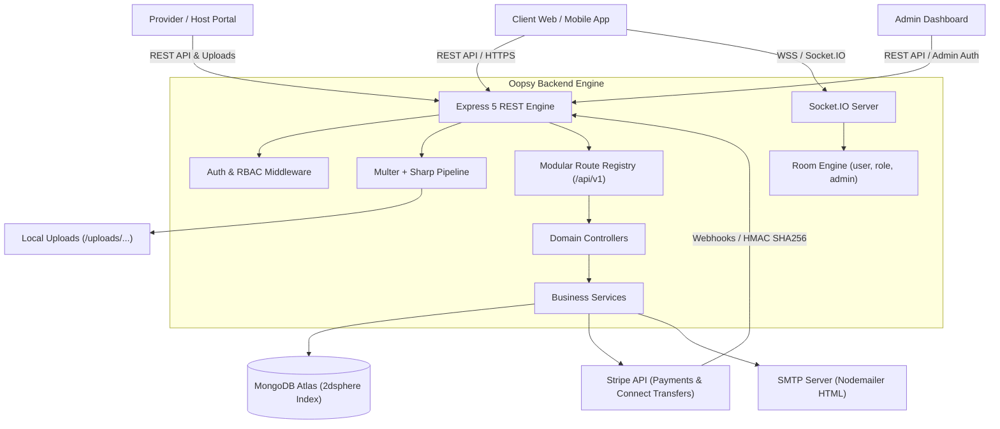

# 🚀 Oopsy Backend Engine

[](https://nodejs.org/)
[](https://www.typescriptlang.org/)
[](https://expressjs.com/)
[](https://www.mongodb.com/)
[](https://socket.io/)
[](https://stripe.com/)
[](http://localhost:5000/api-docs)
[](https://opensource.org/licenses/ISC)

> Enterprise-grade, multi-tenant RESTful API and real-time WebSocket backend engine powering the **Oopsy** marketplace and facility booking platform. Seamlessly connects clients with space and facility hosts, equipped with automated Stripe payments, host payout transfers via Stripe Connect, geospatial map search, multi-axis reviews, dispute resolution, and super-admin platform governance.

---

## 📑 Table of Contents

- [Overview & Core Capabilities](#-overview--core-capabilities)
- [System Architecture](#-system-architecture)
- [Technology Stack](#-technology-stack)
- [Project Directory Structure](#-project-directory-structure)
- [Role-Based Access Control (RBAC)](#-role-based-access-control-rbac)
- [Prerequisites](#-prerequisites)
- [Installation & Setup](#-installation--setup)
- [Environment Variables Configuration](#-environment-variables-configuration)
- [Database Bootstrapping & Seeding](#-database-bootstrapping--seeding)
- [API Reference](#-api-reference)
  - [System Health & Status](#1-system-health--status)
  - [Authentication & User Management](#2-authentication--user-management)
  - [Categories & Facility Types](#3-categories--facility-types)
  - [Listings & Geospatial Discovery](#4-listings--geospatial-discovery)
  - [Bookings & Schedules](#5-bookings--schedules)
  - [Payments & Stripe Webhooks](#6-payments--stripe-webhooks)
  - [Host Payouts & Stripe Connect](#7-host-payouts--stripe-connect-withdraw)
  - [Multi-Axis Reviews & Host Replies](#8-multi-axis-reviews--host-replies)
  - [Dispute Resolution](#9-dispute-resolution)
  - [Favorites & Bookmarks](#10-favorites--bookmarks)
  - [Notifications & Role Broadcasts](#11-notifications--role-broadcasts)
  - [Platform Moderation & Reports](#12-platform-moderation--reports)
  - [Platform Settings & Commission](#13-platform-settings--commission)
  - [Legal Policies & Public FAQs](#14-legal-policies--public-faqs)
- [Real-Time WebSockets (Socket.IO)](#-real-time-websockets-socketio)
- [Stripe Integration & Local Webhooks](#-stripe-integration--local-webhooks)
- [Media Processing Pipeline (Multer & Sharp)](#-media-processing-pipeline-multer--sharp)
- [Error Handling & API Response Standard](#-error-handling--api-response-standard)
- [Postman Collection](#-postman-collection)
- [Available NPM Scripts](#-available-npm-scripts)
- [Production Deployment & Process Management](#-production-deployment--process-management)
- [License](#-license)

---

## 🌟 Overview & Core Capabilities

The **Oopsy Backend Engine** is architected to power an on-demand facility and space booking ecosystem:

- 🏢 **Multi-Role Marketplace**: Native workflows for `CLIENT` (customers booking facilities), `PROVIDER` (facility hosts/owners), and `SUPER_ADMIN` (platform managers).
- 🗺️ **Geospatial Discovery (2dsphere)**: Map-based bounding box filtering (`minLat`, `maxLat`, `minLng`, `maxLng`) powered by native MongoDB spherical indexes.
- 💳 **End-to-End Stripe Monetization**:
  - Secure Stripe Checkout / PaymentIntents for customer bookings.
  - Automated platform commission fee calculation & settlement.
  - Stripe Connect onboarding and automated payouts/transfers directly to provider bank accounts.
  - Cryptographically verified Stripe webhook listener (`/api/v1/payments/webhook`).
- ⏱️ **Flexible Availability & Tiered Pricing**:
  - Hosts specify multiple pricing tiers (e.g. 30 min / £6, 60 min / £10).
  - Day-by-day availability slots with custom opening and closing hours.
- 💬 **Real-Time WebSocket Layer**:
  - Instant socket connections with user and role rooms (`user_{id}`, `super_admins`, `providers`, `clients`).
  - Real-time updates for notifications, booking status shifts, and administrator alerts.
- ⭐ **Multi-Dimensional Reviews**:
  - Granular 5-axis ratings: Cleanliness, Safety, Facilities, Privacy, and Service Quality.
  - Verified booking verification, aggregate distribution analytics, and host response threads.
- ⚖️ **Dispute & Refund Workflow**:
  - Formal customer/host dispute submissions with image evidence and reason tags.
  - Super-admin review with one-click resolution and automatic Stripe refund execution.
- 📧 **Rich Transactional Emails**:
  - Nodemailer integrated with responsive HTML email templates for registration verification, OTP codes, password resets, and booking alerts.
- 🖼️ **Automated Media Optimization**:
  - File uploads handled via Multer with automatic image conversion to `.webp` using Sharp.

---

## 🏗️ System Architecture



---

## 🛠️ Technology Stack

| Layer | Technology | Purpose |
| :--- | :--- | :--- |
| **Runtime** | [Node.js](https://nodejs.org/) (v18+) | High-performance asynchronous JavaScript runtime |
| **Language** | [TypeScript](https://www.typescriptlang.org/) (v5.9) | Static typing, interface definitions, and developer safety |
| **Web Framework** | [Express.js](https://expressjs.com/) (v5.2) | HTTP routing, custom middlewares, and API controllers |
| **Database & ODM** | [MongoDB](https://www.mongodb.com/) / [Mongoose](https://mongoosejs.com/) (v9.2) | Schemas, 2dsphere indexing, population, transactions |
| **Real-Time** | [Socket.IO](https://socket.io/) (v4.8) | Bi-directional event communication and user/role room subscriptions |
| **Payments** | [Stripe SDK](https://stripe.com/) (v23.0) | PaymentIntents, Connect Express onboarding, transfers, webhooks |
| **Authentication** | `jsonwebtoken` & `bcrypt` (v6.0) | JWT token rotation (Access/Refresh), salted password hashing |
| **Media Processing**| `multer` (v2.1) & `sharp` (v0.35) | Multi-part uploads, image resizing, and conversion to WebP |
| **Validation** | [Zod](https://zod.dev/) (v4.3) | Request body validation schemas and error normalization |
| **Mailer** | [Nodemailer](https://nodemailer.com/) (v9.0) | SMTP transporter with modern HTML transactional emails |
| **Task Automation**| `node-cron` (v4.2) | Scheduled background jobs and maintenance tasks |

---

## 📂 Project Directory Structure

```text
oopsy-backend/
├── dist/                          # Compiled JavaScript production build
├── public/                        # Static HTML landing page & operational monitor
│   └── index.html                 # Real-time health dashboard with live status
├── uploads/                       # File upload storage
│   ├── category-icons/            # Category thumbnails
│   ├── listing-photos/            # Optimized listing imagery (WebP)
│   ├── profile-images/            # User avatar images
│   ├── review-photos/             # User photo evidence for reviews
│   └── user-documents/            # Host ID cards and business proof (PDFs/Images)
├── src/
│   ├── app/
│   │   ├── config/                # Environment variables loader and exporter
│   │   │   └── index.ts
│   │   ├── middlewares/           # Global and route-level middlewares
│   │   │   ├── auth.ts            # JWT verification and user hydration
│   │   │   ├── authorized.ts      # Role-based access control guard
│   │   │   ├── checkAuth.ts       # Optional authentication extractor
│   │   │   ├── multer.ts          # Storage engines, Sharp filters, and upload handlers
│   │   │   └── validateRequest.ts # Zod schema validator middleware
│   │   ├── modules/               # Domain-driven feature modules
│   │   │   ├── auth/              # Auth routes, models, verification, tokens, superadmin seed
│   │   │   ├── booking/           # Facility booking lifecycle & scheduling
│   │   │   ├── category/          # Facility types and categories
│   │   │   ├── dispute/           # Customer/Host dispute handling & admin resolution
│   │   │   ├── faq/               # Public FAQ knowledgebase
│   │   │   ├── favorite/          # User bookmarks and saved listings
│   │   │   ├── listing/           # Space listings, pricing tiers, 2dsphere maps
│   │   │   ├── notification/      # User notifications and superadmin broadcast
│   │   │   ├── payment/           # Payment intents, payment history, refunds
│   │   │   ├── public/            # Dynamic legal policies (Terms, Privacy, Refund)
│   │   │   ├── report/            # User/Listing reporting & moderation
│   │   │   ├── review/            # 5-axis reviews, stats, and host replies
│   │   │   ├── setting/           # System settings, platform commission, maintenance mode
│   │   │   ├── stripe/            # Stripe service helpers and webhook handler
│   │   │   └── withdraw/          # Host payouts, Stripe Connect account onboarding
│   │   ├── routes/                # Central API router registry
│   │   │   └── index.ts
│   │   └── socket/                # Socket.IO initialization and room broadcasting
│   │       └── socket.ts
│   ├── errors/                    # Normalized errors and global error handler
│   │   ├── ApiError.ts            # Custom operational API error class
│   │   ├── globalErrorhandler.ts  # Express 4-argument global error interceptor
│   │   ├── handleCastError.ts     # Mongoose invalid ObjectId formatting
│   │   ├── handleDuplicateError.ts# MongoDB unique index violation formatting
│   │   ├── handleValidationError.ts# Mongoose schema validation formatting
│   │   ├── handleZodError.ts      # Zod schema validation error parser
│   │   └── notFound.ts            # 404 Route not found handler
│   ├── types/                     # Global TypeScript interfaces
│   ├── utils/                     # Utility libraries and helpers
│   │   ├── catchAsync.ts          # Async route wrapper avoiding try/catch boilerplate
│   │   ├── emailTemplates.ts      # Transactional HTML email templates
│   │   ├── fileHelper.ts          # File deletion and path resolution utilities
│   │   ├── jwtHelper.ts           # Token generation and verification
│   │   ├── nodemailer.ts          # SMTP transport instance
│   │   ├── notification.ts        # Helper to persist and broadcast notifications
│   │   ├── sendResponse.ts        # Standardized API response builder
│   │   └── tokenGenerator.ts      # Cryptographic OTP and token generator
│   ├── app.ts                     # Express app configuration & middleware pipeline
│   └── server.ts                  # Server entry point, DB bootstrap & graceful shutdown
├── .env.example                   # Environment configuration template
├── package.json                   # Project manifest and scripts
├── postman_auth_collection.json   # Ready-to-use Postman collection
└── tsconfig.json                  # TypeScript compiler configuration
```

---

## 👥 Role-Based Access Control (RBAC)

Oopsy implements a strict 3-tier user role hierarchy:

| Capability | Public / Guest | CLIENT (Customer) | PROVIDER (Host) | SUPER_ADMIN (Platform) |
| :--- | :---: | :---: | :---: | :---: |
| Browse Listings & Search Map | ✅ | ✅ | ✅ | ✅ |
| View Categories, FAQs, Policies | ✅ | ✅ | ✅ | ✅ |
| Register & Verify Account | ✅ | ✅ | ✅ | — |
| Create Bookings & Pay via Stripe | ❌ | ✅ | ❌ | ❌ |
| Create & Manage Facility Listings | ❌ | ❌ | ✅ | Full Moderation |
| Connect Stripe Account (Payouts) | ❌ | ❌ | ✅ | Full Oversight |
| Request Earnings Withdrawal | ❌ | ❌ | ✅ | Review & Accept/Reject |
| Submit Review with 5-Axis Ratings | ❌ | ✅ | ❌ | Moderate |
| Reply to Reviews | ❌ | ❌ | ✅ (Own listings) | Moderate |
| Open Disputes | ❌ | ✅ | ✅ | Resolve & Trigger Refund |
| Report Abuse (User/Listing) | ❌ | ✅ | ✅ | Review & Dismiss/Resolve |
| Broadcast System Notifications | ❌ | ❌ | ❌ | ✅ |
| Configure Platform Commission | ❌ | ❌ | ❌ | ✅ |

---

## 📋 Prerequisites

Ensure your host environment satisfies the following requirements:

- **Node.js**: `v18.0.0` or higher (`v20.x+` recommended)
- **NPM**: `v9.x` or higher (or `pnpm` / `yarn`)
- **MongoDB**: MongoDB Server `v6.0+` locally or a [MongoDB Atlas](https://www.mongodb.com/atlas) Cluster URI.
- **Stripe Account**: Standard account with Stripe Connect enabled in test or live mode.
- **SMTP Server**: Valid credentials (e.g. Gmail App Password or SendGrid/Postmark) for transactional emails.

---

## ⚡ Installation & Setup

### 1. Clone the Repository
```bash
git clone https://github.com/apponislam/oopsy-backend.git
cd oopsy-backend
```

### 2. Install Dependencies
```bash
npm install
```

### 3. Configure Environment Variables
Duplicate `.env.example` into a new `.env` file:
```bash
cp .env.example .env
```
Open `.env` and provide your specific MongoDB connection string, Stripe keys, JWT secrets, and SMTP credentials.

### 4. Run Development Server
```bash
npm run dev
```
The server will boot with live reload via `ts-node-dev`:
```text
✅ App listening on port 5000 on 0.0.0.0
🔌 Socket server initialized
✅ Super admin created / verified
```

### 5. Verify Installation
- **Web Dashboard**: Open [http://localhost:5000/](http://localhost:5000/) in your browser to inspect the operational status page.
- **Health Check API**: Send a `GET` request to `http://localhost:5000/api/v1/status`:
```json
{
  "success": true,
  "data": {
    "environment": "development",
    "port": 5000,
    "uptime": 12.35,
    "timestamp": "2026-10-28T12:00:00.000Z"
  }
}
```

---

## ⚙️ Environment Variables Configuration

| Variable | Type | Default / Example | Required | Description |
| :--- | :---: | :--- | :---: | :--- |
| `IP` | String | `0.0.0.0` | No | Host IP address to bind server |
| `NODE_ENV` | String | `development` | Yes | App mode: `development` \| `production` |
| `PORT` | Number | `5000` | Yes | HTTP server listening port |
| `MONGODB_URL` | String | `mongodb+srv://...` | Yes | MongoDB Atlas / Local connection URI |
| `CLIENT_URL` | String | `http://localhost:3000` | Yes | Frontend application origin (for CORS & email links) |
| `SERVER_URL` | String | `http://localhost:5000` | Yes | Backend public base URL (for media asset resolution) |
| `BCRYPT_SALT_ROUNDS` | Number | `12` | Yes | Cost factor for password hashing |
| `JWT_ACCESS_SECRET` | String | `<random_secret>` | Yes | HMAC secret for signing access tokens |
| `JWT_ACCESS_EXPIRE` | String | `30d` | Yes | Lifespan of access token (e.g. `15m`, `30d`) |
| `JWT_REFRESH_SECRET` | String | `<random_secret>` | Yes | HMAC secret for signing refresh tokens |
| `JWT_REFRESH_EXPIRE` | String | `365d` | Yes | Lifespan of refresh token |
| `JWT_PASSWORD_RESET_SECRET`| String | `<random_secret>` | Yes | Secret for password reset verification tokens |
| `SMTP_HOST` | String | `smtp.gmail.com` | Yes | SMTP server hostname |
| `SMTP_PORT` | Number | `587` | Yes | SMTP server port (`587` TLS or `465` SSL) |
| `SMTP_SECURE` | Boolean| `false` | Yes | Set `true` if port 465, else `false` |
| `SMTP_USER` | String | `user@example.com` | Yes | SMTP authentication username / sender |
| `SMTP_PASS` | String | `app_password` | Yes | SMTP authentication password or app key |
| `INITIAL_ADMIN_NAME` | String | `Super Admin` | Yes | Display name for bootstrapped super admin |
| `INITIAL_ADMIN_EMAIL`| String | `admin@example.com` | Yes | Login email for bootstrapped super admin |
| `INITIAL_ADMIN_PASSWORD` | String | `ChangeMe123!` | Yes | Login password for bootstrapped super admin |
| `INITIAL_ADMIN_PHONE`| String | `+1234567890` | Yes | Phone number for bootstrapped super admin |
| `STRIPE_PUBLISHABLE_KEY` | String | `pk_test_...` | Yes | Stripe publishable API key |
| `STRIPE_SECRET_KEY` | String | `sk_test_...` | Yes | Stripe secret API key |
| `STRIPE_WEBHOOK_SECRET` | String | `whsec_...` | Yes | Stripe endpoint signing secret for webhooks |

---

## 🧬 Database Bootstrapping & Seeding

On startup (`src/server.ts`), the application connects to MongoDB and invokes `seedSuperAdmin()`:

1. Checks if any user with `role: "SUPER_ADMIN"` exists in the database.
2. If none exists, it reads `INITIAL_ADMIN_NAME`, `INITIAL_ADMIN_EMAIL`, `INITIAL_ADMIN_PASSWORD`, and `INITIAL_ADMIN_PHONE` from the environment.
3. Hashes the password using `bcrypt` and creates the primary Super Admin account with `isEmailVerified: true` and `isApproved: true`.
4. Subsequent server starts detect the existing admin and safely skip seeding.

---

## 📡 API Reference

All RESTful endpoints are prefixed with `/api/v1`.

### 1. System Health & Documentation

| Method | Endpoint | Access | Description |
| :--- | :--- | :---: | :--- |
| `GET` | `/` | Public | Visual HTML operational dashboard |
| `GET` | `/api-docs` | Public | **Interactive Swagger OpenAPI 3.0 Documentation** |
| `GET` | `/docs` | Public | Convenient alias for Swagger UI |
| `GET` | `/api-docs.json` | Public | Raw OpenAPI 3.0 JSON specification schema |
| `GET` | `/api/v1/status` | Public | JSON health check, uptime, environment, and server time |

---

### 2. Authentication & User Management
**Base Path**: `/api/v1/auth`

| Method | Endpoint | Access | Description |
| :--- | :--- | :---: | :--- |
| `POST` | `/register` | Public | Register new `CLIENT` or `PROVIDER` (`multipart/form-data`) |
| `POST` | `/login` | Public | Authenticate user; returns JWT access token & sets refresh cookie |
| `GET` | `/verify-email` | Public | Verify registration email using token from verification link |
| `POST` | `/resend-verification` | Public | Resend email verification code/link |
| `POST` | `/refresh-token` | Public | Exchange refresh token cookie for a fresh access token |
| `POST` | `/forgot-password` | Public | Request password reset 6-digit OTP sent to registered email |
| `POST` | `/verify-otp` | Public | Verify OTP code; returns temporary password reset token |
| `POST` | `/resend-otp` | Public | Resend password reset OTP |
| `POST` | `/reset-password` | Public | Update password using reset token |
| `GET` | `/me` | Authenticated | Fetch authenticated user profile & balance details |
| `POST` | `/logout` | Authenticated | Invalidate session and clear refresh token cookie |
| `PATCH`| `/profile` | Authenticated | Update user profile, address, business details, or avatar |
| `POST` | `/change-password` | Authenticated | Change password by verifying `oldPassword` |
| `DELETE`| `/delete-account` | Authenticated | Soft delete user account (`isDeleted: true`) |
| `POST` | `/update-email` | Authenticated | Initiate email address change; sends token to new email |
| `GET` | `/verify-new-email` | Public | Confirm and switch to new email address |
| `POST` | `/resend-email-update`| Authenticated | Resend confirmation link to pending new email |
| `GET` | `/users/:userId` | `SUPER_ADMIN` | View any user's detailed profile and documents |
| `POST` | `/set-password/:userId` | Authenticated | Admin/Owner manual password reset |
| `PATCH`| `/users/:userId` | `SUPER_ADMIN` | Admin update user status, verification, or approval |

#### Register Payload Example (`multipart/form-data`)
```form-data
name: "Jane Host"
email: "jane@example.com"
password: "SecurePassword123!"
role: "PROVIDER"  # "CLIENT" or "PROVIDER"
phone: "+14155552671"
website: "https://janehostings.com"
address: {"street":"456 Market St","city":"San Francisco","state":"CA","zipCode":"94105","country":"USA","location":{"type":"Point","coordinates":[-122.399,37.791]}}
businessDetails: {"businessName":"Bay Area Spaces","businessType":"Hospitality","companyRegistrationNumber":"BC-98124","vatNumber":"US-882194"}
profileImage: [File]
businessDocument: [File]
governmentIssuedId: [File]
referralCode: "PIT67FU9"  # Optional
```

---

### 3. Categories & Facility Types
**Base Path**: `/api/v1/categories`

| Method | Endpoint | Access | Description |
| :--- | :--- | :---: | :--- |
| `GET` | `/` | Public | List all active facility categories (e.g. Studios, Desks, Gyms) |
| `GET` | `/admin` | `SUPER_ADMIN` | List all categories including inactive and deleted |
| `GET` | `/:id` | Public | Get single category details by ID |
| `POST` | `/` | `SUPER_ADMIN` | Create new category with icon image (`uploadCategoryImage`) |
| `PATCH`| `/:id/status` | `SUPER_ADMIN` | Toggle category active/inactive status |
| `PATCH`| `/:id` | `SUPER_ADMIN` | Update category title, slug, or icon |
| `DELETE`| `/:id` | `SUPER_ADMIN` | Soft delete category |

---

### 4. Listings & Geospatial Discovery
**Base Path**: `/api/v1/listings`

| Method | Endpoint | Access | Description |
| :--- | :--- | :---: | :--- |
| `GET` | `/map` | Public | Bounding box spatial search: `minLat`, `maxLat`, `minLng`, `maxLng` |
| `GET` | `/` | Public (Optional Auth)| Paginated search with filters: `search`, `category`, `minPrice`, `maxPrice`, `rating` |
| `GET` | `/admin` | `SUPER_ADMIN` | List all listings across platform with approval status |
| `GET` | `/my/listings` | `PROVIDER` | Retrieve listings owned by the logged-in host |
| `GET` | `/:id` | Public (Optional Auth)| Get comprehensive listing details, pricing tiers, and host info |
| `POST` | `/` | `PROVIDER` | Create listing with up to 10 photos converted to WebP |
| `PATCH`| `/:id/status` | `PROVIDER` | Toggle listing active/inactive visibility |
| `PATCH`| `/:id` | `PROVIDER` | Update listing specifications, tiers, or photos |
| `DELETE`| `/:id` | `PROVIDER` | Soft delete listing |

#### Map Query Example
```http
GET /api/v1/listings/map?minLat=40.70&maxLat=40.80&minLng=-74.02&maxLng=-73.92&limit=50
```

---

### 5. Bookings & Schedules
**Base Path**: `/api/v1/bookings`

| Method | Endpoint | Access | Description |
| :--- | :--- | :---: | :--- |
| `POST` | `/` | `CLIENT` | Create booking for a listing time slot |
| `GET` | `/my-bookings` | Authenticated | List bookings (as customer or as host with filters: `status`, `searchTerm`) |
| `GET` | `/:id` | Authenticated | View single booking details |
| `PATCH`| `/:id/cancel` | Authenticated | Cancel booking with `cancelReason` |

#### Create Booking Body
```json
{
  "listing": "66f42b3c7d1e8a0012345678",
  "date": "2026-11-15T00:00:00.000Z",
  "time": "14:00",
  "durationMinutes": 60,
  "price": 25.00
}
```

---

### 6. Payments & Stripe Webhooks
**Base Path**: `/api/v1/payments`

| Method | Endpoint | Access | Description |
| :--- | :--- | :---: | :--- |
| `POST` | `/webhook` | Stripe Webhook | Raw body webhook listener verifying `stripe-signature` |
| `POST` | `/create-payment-intent`| `CLIENT` | Initialize Stripe PaymentIntent for a pending booking |
| `POST` | `/create` | Authenticated | Direct record creation after client payment confirmation |
| `GET` | `/history` | Authenticated | View personal payment history (sent or received) |
| `GET` | `/:id` | Authenticated | View single payment record |
| `GET` | `/admin` | `SUPER_ADMIN` | View platform-wide ledger with commission fee settlement |
| `GET` | `/admin/:id` | `SUPER_ADMIN` | View single payment details with fee audit |
| `POST` | `/refund` | `SUPER_ADMIN` | Issue full/partial refund via Stripe API |

---

### 7. Host Payouts & Stripe Connect (Withdraw)
**Base Path**: `/api/v1/withdraw`

| Method | Endpoint | Access | Description |
| :--- | :--- | :---: | :--- |
| `POST` | `/connect-account` | `PROVIDER` | Create Stripe Connected Express account for host |
| `POST` | `/connect-onboarding` | `PROVIDER` | Generate Stripe Connect Onboarding Account Link URL |
| `POST` | `/request` | `PROVIDER` | Request balance withdrawal (`amount`) |
| `GET` | `/history` | `PROVIDER` | View host withdrawal history & status |
| `GET` | `/:id` | `PROVIDER` | View single withdrawal request |
| `GET` | `/admin` | `SUPER_ADMIN` | View all pending and processed payout requests |
| `PATCH`| `/:id/accept` | `SUPER_ADMIN` | Approve payout: triggers Stripe Transfer directly to host bank |
| `PATCH`| `/:id/reject` | `SUPER_ADMIN` | Reject payout with `rejectionReason`; refunds host balance |
| `GET` | `/stripe/return` | Public | Return URL after completing Stripe onboarding |
| `GET` | `/stripe/reauth` | Public | Refresh URL if Stripe onboarding session expires |

---

### 8. Multi-Axis Reviews & Host Replies
**Base Path**: `/api/v1/reviews`

| Method | Endpoint | Access | Description |
| :--- | :--- | :---: | :--- |
| `GET` | `/listing/:listingId` | Public | Fetch paginated reviews for a specific listing |
| `GET` | `/listing/:listingId/stats`| Public | Fetch aggregate stats: overall rating, category averages, histogram |
| `GET` | `/user/:userId` | Public | Fetch public reviews authored by a specific user |
| `GET` | `/:id` | Public | View single review |
| `POST` | `/` | `CLIENT` | Submit review with 5 rating categories & photos |
| `GET` | `/my-reviews` | `CLIENT` | Get all reviews submitted by the logged-in user |
| `PATCH`| `/:id` | `CLIENT` | Update review comment or category ratings |
| `DELETE`| `/:id` | `CLIENT` | Delete review (recalculates listing rating) |
| `POST` | `/:id/reply` | `PROVIDER` | Host reply to customer review |
| `PATCH`| `/:id/reply` | `PROVIDER` | Host update reply comment |
| `DELETE`| `/:id/reply` | `PROVIDER` | Host remove reply |

#### Create Review Body (`multipart/form-data`)
```json
{
  "booking": "66f42b3c7d1e8a0012345678",
  "listing": "66f42b3c7d1e8a0087654321",
  "rating": 5,
  "categories": {
    "cleanliness": 5,
    "safety": 5,
    "facilities": 4,
    "privacy": 5,
    "serviceQuality": 5
  },
  "comment": "Exceptional private space, sparkling clean with ultra-fast WiFi!"
}
```

---

### 9. Dispute Resolution
**Base Path**: `/api/v1/disputes`

| Method | Endpoint | Access | Description |
| :--- | :--- | :---: | :--- |
| `POST` | `/` | Authenticated | Open dispute on a booking (`reason`, `description`, `images`, `refundRequested`, `refundAmount`) |
| `GET` | `/my-disputes` | Authenticated | View disputes opened by or against the current user |
| `GET` | `/:id` | Authenticated | View dispute details (Initiator, Defendant, or Super Admin) |
| `PATCH`| `/:id/cancel` | Authenticated | Cancel own pending dispute |
| `GET` | `/` | `SUPER_ADMIN` | View all platform disputes with filtering |
| `PATCH`| `/:id/resolve` | `SUPER_ADMIN` | Resolve dispute (`RESOLVED_REFUNDED` or `RESOLVED_REJECTED`) |

---

### 10. Favorites & Bookmarks
**Base Path**: `/api/v1/favorites`

| Method | Endpoint | Access | Description |
| :--- | :--- | :---: | :--- |
| `POST` | `/toggle` | Authenticated | Add/remove a listing from personal favorites |
| `GET` | `/` | Authenticated | View paginated list of user's bookmarked listings |

---

### 11. Notifications & Role Broadcasts
**Base Path**: `/api/v1/notifications`

| Method | Endpoint | Access | Description |
| :--- | :--- | :---: | :--- |
| `GET` | `/` | Authenticated | Fetch paginated user notifications with unread counts |
| `PATCH`| `/mark-all-read` | Authenticated | Mark all notifications as read |
| `PATCH`| `/:id/read` | Authenticated | Mark individual notification as read |
| `DELETE`| `/clear-all` | Authenticated | Delete all notifications for current user |
| `DELETE`| `/:id` | Authenticated | Delete individual notification |
| `POST` | `/admin/send` | `SUPER_ADMIN` | Broadcast notification to specific users or entire roles (`CLIENT`, `PROVIDER`) |

---

### 12. Platform Moderation & Reports
**Base Path**: `/api/v1/reports`

| Method | Endpoint | Access | Description |
| :--- | :--- | :---: | :--- |
| `POST` | `/` | Authenticated | Submit report against a `LISTING` or `USER` |
| `GET` | `/` | `SUPER_ADMIN` | View all submitted reports |
| `GET` | `/:id` | `SUPER_ADMIN` | View single report details |
| `PATCH`| `/:id/status` | `SUPER_ADMIN` | Update status: `PENDING`, `RESOLVED`, or `DISMISSED` |

---

### 13. Platform Settings & Commission
**Base Path**: `/api/v1/settings`

| Method | Endpoint | Access | Description |
| :--- | :--- | :---: | :--- |
| `GET` | `/` | Public | Retrieve public platform parameters |
| `PATCH`| `/` | `SUPER_ADMIN` | Update commission rate, support email, maintenance mode, or booking limits |

#### Settings Schema
```json
{
  "supportEmail": "support@oopsy.com",
  "defaultCommissionPercentage": 10,
  "maxAdvanceBookingDays": 60,
  "emailNotifications": true,
  "pushNotifications": true,
  "allowNewRegistrations": true,
  "autoApproveReviews": true,
  "maintenanceMode": false
}
```

---

### 14. Legal Policies & Public FAQs

#### Public Policies (`/api/v1/public`)
| Method | Endpoint | Access | Description |
| :--- | :--- | :---: | :--- |
| `GET` | `/:type` | Public | Read policy (`terms-and-conditions`, `privacy-policy`, `refund-policy`) |
| `POST` | `/` | `SUPER_ADMIN` | Upsert policy content (Markdown/HTML) |

#### Public FAQs (`/api/v1/faqs`)
| Method | Endpoint | Access | Description |
| :--- | :--- | :---: | :--- |
| `GET` | `/` | Public | Fetch all active FAQs grouped by category |
| `POST` | `/` | `SUPER_ADMIN` | Create new FAQ entry |
| `PATCH`| `/:id` | `SUPER_ADMIN` | Update FAQ question or answer |
| `DELETE`| `/:id` | `SUPER_ADMIN` | Delete FAQ entry |

---

## ⚡ Real-Time WebSockets (Socket.IO)

The engine boots a Socket.IO server alongside the Express HTTP listener (`src/app/socket/socket.ts`).

### Connection Handshake
Clients authenticate by passing their user `_id` in the handshake `auth` object:

```javascript
import { io } from "socket.io-client";

const socket = io("https://api.yourdomain.com", {
  auth: {
    _id: "66f42b3c7d1e8a0012345678" // User MongoDB ID
  },
  transports: ["websocket", "polling"]
});

socket.on("connect", () => {
  console.log("Connected with socket ID:", socket.id);
});
```

### Auto-Joined Socket Rooms
Upon successful handshake, the user is automatically assigned to specialized rooms:
1. `user_{userId}`: Personal inbox for private alerts, booking updates, and receipts.
2. `super_admins`: Receives new dispute alerts, payout requests, and reports (if user has `role: "SUPER_ADMIN"`).
3. `providers`: Receives incoming booking requests and review alerts (if user has `role: "PROVIDER"`).
4. `clients`: Receives booking confirmations and promotion broadcasts (if user has `role: "CLIENT"`).

### Built-In Events
- **`ping`**: Emit `ping` from client to receive `pong` acknowledgment for latency testing.
- **`notification`**: Inbound event when a new notification is generated for the authenticated user.

---

## 💳 Stripe Integration & Local Webhooks

### 1. Stripe Connect Workflow
1. Host requests onboarding link via `POST /api/v1/withdraw/connect-account` followed by `POST /api/v1/withdraw/connect-onboarding`.
2. Host completes Identity & Bank account setup on Stripe's hosted Express portal.
3. Upon completion, host can request withdrawals.
4. When Super Admin approves the payout via `PATCH /api/v1/withdraw/:id/accept`, the system triggers `stripe.transfers.create()` to disburse funds.

### 2. Testing Stripe Webhooks Locally
Stripe webhooks require raw body parsing (configured at `app.use("/api/v1/payments/webhook", express.raw(...))`).

To test locally using the [Stripe CLI](https://stripe.com/docs/stripe-cli):
```bash
# 1. Login to Stripe
stripe login

# 2. Forward events to your local server
stripe listen --forward-to localhost:5000/api/v1/payments/webhook
```
Copy the webhook signing secret output by the CLI (starts with `whsec_...`) and place it in your `.env` as `STRIPE_WEBHOOK_SECRET`.

---

## 🖼️ Media Processing Pipeline (Multer & Sharp)

All uploaded images undergo an automated processing pipeline (`src/app/middlewares/multer.ts`):
1. **Multer Memory Storage**: Files are captured in memory buffer without writing raw, unoptimized files to disk.
2. **Sharp Image Conversion**:
   - Re-encoded to modern **WebP** (`.webp`) format for up to 80% bandwidth reduction.
   - Quality optimized to `80%`.
   - Dimensions normalized (e.g. Profile photos resized to `500x500` cover, listing photos up to `1600x1200` fit).
3. **Storage Structure**:
   - Saved with unique filenames (e.g. `profile-171890-4821.webp`) into `/uploads/...`.
   - Statically served via Express at `/uploads/*`.

---

## 🛡️ Error Handling & API Response Standard

### Success Response Standard
All controllers utilize `sendResponse()` for uniform JSON formatting:
```json
{
  "success": true,
  "message": "Listings fetched successfully",
  "data": [ ... ],
  "meta": {
    "page": 1,
    "limit": 10,
    "total": 45,
    "totalPages": 5,
    "hasNext": true,
    "hasPrev": false
  }
}
```

### Error Response Standard
All runtime, database, validation, and operational errors pass through `globalErrorHandler`:
```json
{
  "success": false,
  "message": "Validation Error",
  "errorSources": [
    {
      "path": "email",
      "message": "Invalid email address format"
    }
  ],
  "err": { ... },
  "stack": "Error: ... (Included in development mode only)"
}
```

---

## 📮 Postman Collection

A pre-configured Postman collection is included in the root directory:
- 📄 **File**: [`postman_auth_collection.json`](file:///e:/New%20Project/ypavlo86/oopsy-backend/postman_auth_collection.json)

### How to Import & Use
1. Open Postman -> Click **Import** -> Select `postman_auth_collection.json`.
2. Configure Collection Variables:
   - `baseUrl`: `http://localhost:5000/api/v1` (or your staging/production URL).
   - `clientToken`: JWT token for testing client endpoints.
   - `providerToken`: JWT token for testing provider endpoints.
   - `adminToken`: JWT token for testing super admin endpoints.
3. Requests include pre-configured headers, form-data bodies, and raw JSON payloads.

---

## 📜 Available NPM Scripts

| Script | Command | Description |
| :--- | :--- | :--- |
| `npm run dev` | `tsx watch src/server.ts` | Start server in development mode with fast hot-reload |
| `npm run build` | `tsc` | Compile TypeScript source code into `dist/` |
| `npm start` | `node dist/server.js` | Run compiled production bundle |
| `npm run lint` | `npx eslint src` | Run ESLint static code analysis |
| `npm run lint:fix`| `npx eslint src --fix` | Automatically fix ESLint warnings and errors |

---

## 🚀 Production Deployment & Process Management

### 1. Build Production Bundle
```bash
npm run build
```

### 2. Run with PM2 Process Manager
Install [PM2](https://pm2.keymetrics.io/) globally to manage the Node.js process:
```bash
npm install -g pm2
pm2 start dist/server.js --name "oopsy-backend" --instances max --exec-mode cluster
pm2 save
pm2 startup
```

### 3. Nginx Reverse Proxy & WebSocket Configuration
When serving behind Nginx, configure proper proxy headers for HTTP and WebSocket upgrades:

```nginx
server {
    server_name api.yourdomain.com;

    location / {
        proxy_pass http://127.0.0.1:5000;
        proxy_http_version 1.1;

        # WebSocket support
        proxy_set_header Upgrade $http_upgrade;
        proxy_set_header Connection "upgrade";

        # Forwarded headers
        proxy_set_header Host $host;
        proxy_set_header X-Real-IP $remote_addr;
        proxy_set_header X-Forwarded-For $proxy_add_x_forwarded_for;
        proxy_set_header X-Forwarded-Proto $scheme;

        # Upload size limit (for high-res photos / documents)
        client_max_body_size 25M;
    }

    listen 443 ssl;
    # SSL certificates managed by Certbot / Let's Encrypt
}
```

---

## 📄 License

This project is licensed under the [ISC License](file:///e:/New%20Project/ypavlo86/oopsy-backend/LICENSE).

---

<p align="center">
  <b>Built with ❤️ for the Oopsy Platform</b><br />
  <sub>High-performance architecture by <a href="https://github.com/apponislam">Appon Islam</a></sub>
</p>
